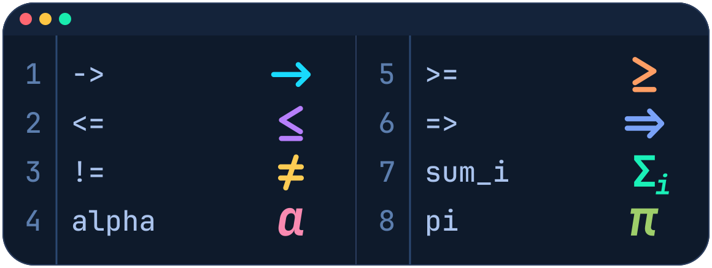

# Prettify Symbols Mode

Prettify symbols mode makes *visual* substitutions to your source code, e.g. displaying `fun` as `λ`, while never touching your code.

This feature is inspired by [prettify-symbols-mode for Emacs](https://www.emacswiki.org/emacs/PrettySymbol).



> **Note:** this is a maintained fork of [siegebell/vsc-prettify-symbols-mode](https://github.com/siegebell/vsc-prettify-symbols-mode), which is no longer maintained. It can be installed next to the original: all commands and settings use the prefix `prettifySymbols` instead of `prettifySymbolsMode`, so existing settings need to be renamed (e.g. `prettifySymbolsMode.substitutions` becomes `prettifySymbols.substitutions`); the old keys are silently ignored. See the [CHANGELOG](CHANGELOG.md) for differences.


## Installation
Install from the [VS Code Marketplace](https://marketplace.visualstudio.com/items?itemName=ColinMoldenhauer.prettify-symbols-mode-continued), or from the Extensions view by searching for `ColinMoldenhauer.prettify-symbols-mode-continued`, or from the command line:

```sh
code --install-extension ColinMoldenhauer.prettify-symbols-mode-continued
```

It is also published on [Open VSX](https://open-vsx.org/extension/ColinMoldenhauer/prettify-symbols-mode-continued), for VSCodium, Eclipse Theia, Gitpod and other editors that use it. To try a prerelease, install a `.vsix` from the [releases page](https://github.com/ColinMoldenhauer/vsc-prettify-symbols-mode/releases):

* from the command line: `code --install-extension prettify-symbols-mode-continued-<version>.vsix`, or
* in VS Code: open the Extensions view, click the `...` menu in its top right corner, choose *Install from VSIX...* and select the file.


## Configuration

Once you have installed this extension, modify  `settings.json` to add language-specific substitutions. For example, the following settings will target F# files, rendering `fun` as `λ`,  `->` as `⟶`, and place a border around parameters.
```json
"prettifySymbols.substitutions": [{
    "language": "fsharp",
    "substitutions": [
      { "ugly": "fun", "pretty": "λ", "scope": "keyword.other.function-definition.fsharp" },
      { "ugly": "->", "pre": "[^->]", "post": "[^->]", "pretty": "⟶" },
      { "ugly": ".+", "scope": "variable.parameter.fsharp", "pre": "^", "post": "$", "style": { "border": "1pt solid green" } }
    ]
}]
```

A substitution matches any string that satisfies the `"ugly"` pattern, visually replacing it with `"pretty"` and/or applying style via `"style"`. You can optionally specify the context by providing `"pre"` or `"post"` regular expressions that must be matched for the substitution to occur. Or you can specify a syntactic scope in which to perform the substitution. You can also target multiple languages or glob patterns at once via `"languages": ["fsharp", {"pattern":  "**/*.txt"}]`.

### Scopes

*Note: scope support is experimental and only available on versions of vscode older than 1.21.1*.

By default, regular expressions match against a whole line of text. If `"scope"` is specified, then regular expression matches will only be performed on the parsed [TextMate] tokens that match the given scope. A small subset of TextMate scope expressions are supported. For example, a substitution with scope `"source.js comment"` will match a token with scope `"text.html.basic source.js comment.block.html"`. A scoped `"ugly"` regular expression must match the entire token by default -- i.e. `"pre"` and `"post"` are respectively set to `"^"` and `"$"` by default when a scope is specified. However, `"pre"` and `"post"` can be overriden to allow multiple substitutions within a single token (e.g. a comment).

*Tip: use [scope-info](https://marketplace.visualstudio.com/items?itemName=siegebell.scope-info) to see the scope assigned to each token in your source.*

### Revealing symbols

By default, "ugly" text will be revealed while contacted by a cursor. You may override this behavior by specifying `"prettifySymbols.revealOn"`, or per-language by specifying `"revealOn"` within a language entry. Options are:
* `"cursor"`: reveal while a cursor contacts the symbol (default);
* `"cursor-inside"`: reveal while a cursor is *inside* the symbol;
* `"active-line"`: reveal all symbols while on the same line as a cursor;
* `"selection"`: reveal all symbols while being selected or in contact with a cursor; or
* `"none"`: do not reveal symbols.

### Pretty cursor

By default, any "pretty" symbol that comes into contact with the cursor will be rendered with a box outline around it. This effect is only visible if the "ugly" text is not revealed (e.g. `"revealOn": "none"`). You can control this setting by specifying `"prettifySymbols.prettyCursor"`, or per-language by specifying `"prettyCursor"` within a language entry. Options are:
* `"boxed"`: display a box around a symbol (only visible if the "ugly" text is not revealed); or
* `"none"`: do not change the appearance of the symbol.

### Insertion position

By default, the "pretty" text is inserted *before* the original text. Specify `"prettifySymbols.insertionPosition"` to change this. Options are:
* `"before"`: insert the "pretty" text before the original text (default); this avoids issues with the syntax highlighting; or
* `"after"`: insert the "pretty" text after the original text.

### Adjust cursor movement

By default, cursor movement will traverse the characters of the "ugly" text -- this will cause it to become invisible while inside the text if it is not revealed (see `"revealOn"`). Setting `"prettifySymbols.adjustCursorMovement"` to `true` will tweak cursor movement so that "pretty" symbols behave as a single character. This can be overriden per-language by specifying `"adjustCursorMovement"` in a language entry. In particular, left or right movement will cause the cursor to jump over the symbol instead of going inside. However, this setting does not currently account for all kinds of cursor movement, e.g. up/down.

### Styling

A tiny subset of CSS can be used to apply styling to the substitution text by setting `"style"`; styles can be specialized for light and dark themes. If `"pretty"` is not specified, then`"style"` must be specified: the result being that all "ugly" matches will have the style applied to them instead of being substituted.

* Supported styles: `"border", "backgroundColor", "color", "textDecoration"` (this list is limited by vscode).
* Themed: e.g. `"dark": {"color": "white"}, "light": {"color": "black"}`
* Unsupported styles: e.g. `"hackCSS": "font-style: italic, font-size: 2em"` (this can easily break rendering)

### Regular expressions

This extension uses [Javascript's regular expression](https://developer.mozilla.org/en-US/docs/Web/JavaScript/Reference/Global_Objects/RegExp) syntax for `"ugly"`, `"pre"`, and `"post"` (but double-escaped because it is parsed by both JSON and regexp). You must avoid using capturing-groups or mis-parenthesized expressions as it will cause substitutions to behave unpredictably (validation is not performed so you will not receive an error message). 

### Commands

The following commands are available for keybinding:
* `prettifySymbols.copyWithSubstitutions`: copy selected text with "pretty" substitutions applied
* `prettifySymbols.enablePrettySymbols`: globally *enable* prettify symbols mode
* `prettifySymbols.disablePrettySymbols`: globally *disable* prettify symbols mode
* `prettifySymbols.togglePrettySymbols`: globally *toggle* prettify symbols mode


### Common settings for `settings.json`

* **Default:** symbols are unfolded as they are traversed by the cursor. 
```json
"prettifySymbols.renderOn": "cursor",
"prettifySymbols.adjustCursorMovement": false,
```
* Suggested alternative: symbols are never unfolded and generally act like a single character w.r.t. cursor movement. 
```json
"prettifySymbols.renderOn": "none",
"prettifySymbols.adjustCursorMovement": true,
```

## Variable-width symbols driving you crazy?

Check out [*Monospacifier*](https://github.com/cpitclaudel/monospacifier) to fix your fonts!


**Quick start example:** if your editor font is Consolas, download and install the [XITS Math fallback font for Consolas](https://github.com/cpitclaudel/monospacifier/blob/master/fonts/XITSMath_monospacified_for_Consolas.ttf?raw=true), then add the following to `settings.json`:
```json
  "editor.fontFamily": "Consolas, 'XITS Math monospacified for Consolas', 'Courier New', monospace"
```

## Known issues:

*Tip: [submit new issues on github](https://github.com/ColinMoldenhauer/vsc-prettify-symbols-mode/issues)*
* You can write bad regular expressions that break substitutions and you will not get an error message.
* The substitutions sometimes get into an inconsistent state when editing. To resolve, reenable prettify-symbols-mode -- this will cause the whole document to be reparsed.

## Examples
[See the wiki for more examples &hyphen; and contribute your own!](https://github.com/ColinMoldenhauer/vsc-prettify-symbols-mode/wiki)

The following shows a brief subset of useful substitutions for Haskell, OCaml, and F#:
```json
"prettifySymbols.revealOn": "cursor",
"prettifySymbols.adjustCursorMovement": false,
"prettifySymbols.substitutions": [{
  "language": "haskell",
  "revealOn": "active-line",
  "substitutions": [
    { "ugly": "\\\\",     "pretty": "λ", "post": "\\s*(?:\\w|_).*?\\s*->" },
    { "ugly": "->",       "pretty": "→" },
    { "ugly": "==",       "pretty": "≡" },
    { "ugly": "not\\s?",  "pretty": "¬", "pre": "\\b", "post": "\\b" },
    { "ugly": ">",        "pretty": ">", "pre": "[^=\\-<>]|^", "post": "[^=\\-<>]|$" },
    { "ugly": "<",        "pretty": "<", "pre": "[^=\\-<>]|^", "post": "[^=\\-<>]|$" },
    { "ugly": ">=",       "pretty": "≥", "pre": "[^=\\-<>]|^", "post": "[^=\\-<>]|$" },
    { "ugly": "<=",       "pretty": "≤", "pre": "[^=\\-<>]|^", "post": "[^=\\-<>]|$" }
  ]},{
  "language": ["ocaml", {"pattern": "**/*.{ml}"}],
  "revealOn": "none",
  "adjustCursorMovement": true,
  "substitutions": [
    { "ugly": "fun",            "pretty": "λ", "pre": "\\b", "post": "\\b" },
    { "ugly": "->",             "pretty": "→", "pre": "[^->]", "post": "[^->]" },
    { "ugly": "List[.]for_all", "pretty": "∀", "pre": "\\b", "post": "\\b" },
    { "ugly": "List[.]exists",  "pretty": "∃", "pre": "\\b", "post": "\\b" },
    { "ugly": "List[.]mem",     "pretty": "∈", "pre": "\\b", "post": "\\b" },
    { "ugly": "\\|",            "pretty": "║", "pre": "^\\s+" }
  ]},{
  "language": "fsharp",
  "substitutions": [
    { "ugly": "fun",           "pretty": "λ", "pre": "\\b", "post": "\\b" },
    { "ugly": "->",            "pretty": "→", "pre": "[^->]", "post": "[^->]" },
    { "ugly": "List[.]forall", "pretty": "∀", "pre": "\\b", "post": "\\b" },
    { "ugly": "List[.]exists", "pretty": "∃", "pre": "\\b", "post": "\\b" },
    { "ugly": ">>",            "pretty": "≫", "pre": "[^=<>]|^", "post": "[^=<>]|$" },
    { "ugly": "<<",            "pretty": "≪", "pre": "[^=<>]|^", "post": "[^=<>]|$" },
    { "ugly": "\\|",           "pretty": "║", "pre": "^\\s+" }
  ]}]
```


## Extension API
The API is [defined here](https://github.com/ColinMoldenhauer/vsc-prettify-symbols-mode/blob/master/src/api.ts).
Usage:
```typescript
const psm = vscode.extensions.getExtension<PrettifySymbolsMode>('ColinMoldenhauer.prettify-symbols-mode-continued');
psm.activate()
    .then(() => {
        context.subscriptions.push(psm.exports.onDidEnabledChange((enabled: boolean) => {
            console.log('Prettify-symbols-mode is changed to: ' + (enabled ? 'enabled' : 'disabled'));
        }));
    });
```


## Development
Requires Node.js (20 or newer) and VS Code ^1.75.0.

```sh
npm ci                   # install dependencies
npm run compile          # compile TypeScript to out/
npm run watch            # recompile on change
npm run package          # build a .vsix into dist/ (version derived from git)
npm run package:install  # build and install it into VS Code (needs the `code` CLI)
```

To try changes without packaging, open the repository in VS Code and press `F5` to launch an Extension Development Host.

`npm run package` takes the version from `git describe --tags`, e.g. `2.0.0-dev` on a tag or `2.0.0-dev-3-gabc1234` between tags (`-dirty` with uncommitted changes), and leaves `package.json` untouched.

### Testing
Install the dependencies once with `npm install`, then run the unit tests with:

```sh
npm test
```

This compiles the sources and runs the [mocha](https://mochajs.org/) tests in `test/` (`*.test.ts`) with plain Node.js; no VS Code instance is needed. The tests do not run inside the extension host: `import 'vscode'` is redirected to a minimal stand-in, [test/vscode-shunt.ts](test/vscode-shunt.ts), via [test/register-vscode.ts](test/register-vscode.ts). If a test needs another part of the VS Code API, add it to the shunt. Use `npm run test-debug` to wait for a debugger (`--inspect-brk`).

Anything that needs the real VS Code (e.g. loading TextMate grammars) is not covered; check it manually in an Extension Development Host (`F5`).

### Releasing
Push a tag of the form `v<major>.<minor>.<patch>`, optionally with a suffix such as `-dev`:

```sh
git tag v2.0.0
git push origin v2.0.0
```

The [release workflow](.github/workflows/release.yml) sets the extension version from the tag (the version in `package.json` is only a placeholder), builds the `.vsix`, attaches it to a GitHub release and, for plain `vX.Y.Z` tags, publishes it to the VS Code Marketplace and Open VSX. Tags with a suffix (e.g. `-dev`) are marked as prereleases and are not published to either registry. The one-time publishing setup (Marketplace and Open VSX) is described in [docs/marketplace-publishing-setup.md](docs/marketplace-publishing-setup.md).


## Credits
This extension is a fork of [vsc-prettify-symbols-mode](https://github.com/siegebell/vsc-prettify-symbols-mode) by Christian J. Bell ([siegebell](https://github.com/siegebell)), which provided the original implementation. The original project is licensed under the MIT license; see [LICENSE](LICENSE).
